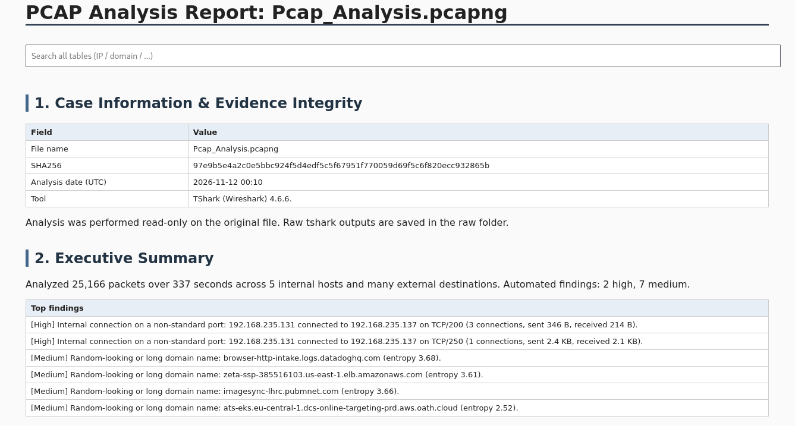
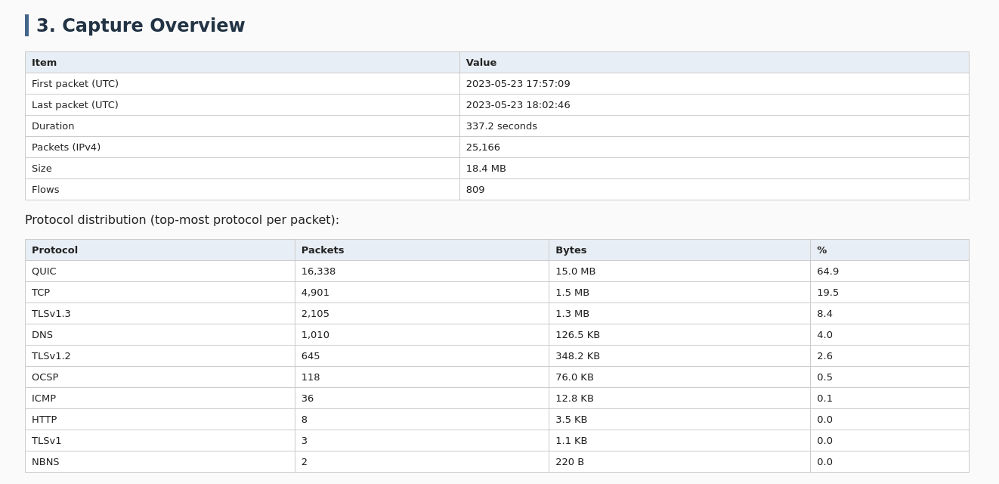

# WireBrief

**From raw PCAP to analyst-ready report, powered by `tshark`. Built with nothing but the Python standard library.**


`wirebrief.py` drives `tshark`, correlates DNS, HTTP, TLS and flow data, applies a set of transparent detection rules mapped to MITRE ATT&CK, and writes a single self-contained **HTML** report (plus a **Markdown** copy).

It is built for SOC analysts, incident responders and DFIR practitioners who need a repeatable, evidence-backed account of what happened in a capture: documented, verifiable and ready to hand over, rather than a pile of raw tshark output.

---
## How to use

Run WireBrief against any capture file:

```bash
python3 wirebrief.py capture.pcapng -o report_out
```


## Why this exists

Raw `tshark` statistics are accurate but hard to read:

- IPs and ports are glued together (`10.0.0.5:51234`), and direction is implicit.
- The same server appears dozens of times because browsers open many parallel connections.
- Ad, CDN and OCSP chatter buries the traffic that actually matters.
- Nothing tells you *what looks suspicious*, or why.

This tool fixes that by **grouping, labelling, filtering noise, and flagging** — while keeping every claim traceable to the raw `tshark` evidence it saves next to the report.

---

## Features

- **Clear conversations.** IP and port are separate columns. The client is the side that sent the first SYN; the server is the listener. Traffic is shown per direction (client → server, server → client).
- **Flow grouping.** Repeated connections to the same server are collapsed into one row with a connection count and total bytes.
- **Noise control.** A user-editable `allowlist.txt` (domain suffixes) moves ad/CDN/OCSP traffic into collapsible sections so suspicious activity stays visible.
- **IP-to-domain correlation.** Destination IPs are labelled with domains learned from DNS answers and TLS SNI found in the same capture.
- **Rule-based detections** with MITRE ATT&CK references (see below).
- **Beaconing detection** based on connection-interval regularity.
- **Extracted HTTP objects**, de-duplicated by SHA-256, with magic-byte file typing.
- **IOC table** with defanged URLs, ready to copy into a ticket or TI platform.
- **Evidence integrity.** SHA-256 of the input file is recorded, and raw `tshark` outputs are saved under `raw/`.
- **Interactive HTML.** Sortable columns, a global search box, collapsible noise sections, severity colouring. One file, no external assets, works offline.
- **Zero dependencies.** Python standard library only.

---

## Requirements

- Python 3.8+
- [`tshark`](https://www.wireshark.org/docs/man-pages/tshark.html) (Wireshark CLI) available in your `PATH`
  - Linux: `sudo apt install tshark`
  - macOS: `brew install wireshark`
  - Windows: install Wireshark and add its folder to `PATH`

TLS JA3 fingerprints are included when your `tshark` version exposes `tls.handshake.ja3`; otherwise that column is skipped automatically.

---

## Usage

```bash
# Basic usage
python3 wirebrief.py capture.pcapng -o report_out

# Custom allowlist location
python3 wirebrief.py capture.pcapng -o report_out --allowlist my_allowlist.txt
```

| Option | Description | Default |
|---|---|---|
| `pcap` | Path to the capture file (`.pcap` / `.pcapng`) | required |
| `-o, --out` | Output directory | `report_<date>` |
| `--allowlist` | File with noise-domain suffixes, one per line | `allowlist.txt` (created on first run) |

### Output

```
report_out/
├── report.html              # main interactive report
├── report.md                # Markdown copy (GitHub-friendly)
└── raw/
    ├── io_stat.txt
    ├── protocol_hierarchy.txt
    ├── endpoints_ip.txt
    ├── conversations_tcp.txt
    └── extracted/           # HTTP objects exported by tshark
```

---

## Report structure

| # | Section | What it answers |
|---|---|---|
| 1 | Case information & evidence integrity | Which file, what hash, which tool version |
| 2 | Executive summary | Auto-generated summary of top findings |
| 3 | Capture overview | Duration, volume, protocol distribution |
| 4 | Internal hosts & conversations | Who talked to whom internally, and on which ports |
| 5 | Top external destinations | Grouped by IP and domain, noise collapsed |
| 6 | DNS analysis | Top queries, NXDOMAIN, random-looking names |
| 7 | HTTP analysis | Cleartext requests, methods, user agents |
| 8 | TLS analysis | SNI names and JA3 fingerprints |
| 9 | Unusual internal connections | Pointer to non-standard internal activity |
| 10 | Beaconing detection | Regular-interval connections |
| 11 | Extracted files | De-duplicated objects with SHA-256 and type |
| 12 | Suspicious findings | Severity-ranked, with evidence and MITRE mapping |
| 13 | IOCs | IPs, domains, defanged URLs, hashes |
| 14 | Limitations & recommendations | Scope caveats and next steps |

---

## Detection rules

Every rule is simple and readable in the source, so you can tune or extend it.

| Finding | Logic | MITRE ATT&CK |
|---|---|---|
| Internal connection on non-standard port | Private-to-private flow where the server port is not in a common-ports list | T1021 / T1571 |
| Large upload to external host | Non-allowlisted destination, ≥ 1 MB sent and more than 3× received | T1041 |
| Executable/script download over HTTP | Request URI ends in `.exe`, `.dll`, `.ps1`, `.bat`, `.vbs`, `.hta`, `.scr`, `.msi`, `.jar`, `.sh`, `.elf`, `.bin` | T1105 |
| Web script over cleartext HTTP | `.php`, `.asp`, `.aspx`, `.jsp`, `.cgi` (internal or external) | T1071.001 |
| HTTP to a direct IP | `Host` header is an IP address | T1071.001 |
| Cleartext POST to external host | `POST` request to a non-private destination | T1048 |
| Unusual User-Agent | Scripting tools or very old browsers (python, curl, wget, PowerShell, Go, Java, MSIE ≤ 6) | T1071.001 |
| High NXDOMAIN volume | 10 or more failed lookups | T1568.002 |
| Random-looking or long domain | Label ≥ 12 chars with Shannon entropy > 3.6, or name > 50 chars | T1568 / T1071.004 |
| Watchlist domain | Paste/file-sharing/tunnel services (e.g. pastebin, ngrok, duckdns) | T1102 / T1567 |
| Beaconing | ≥ 6 connections to one destination, mean interval ≥ 3 s, coefficient of variation < 0.25 | T1071 / T1029 |
| Executable extracted from traffic | PE or ELF magic bytes in an exported HTTP object | T1105 |

> These are **heuristics for triage**. A finding is a lead to verify, not a verdict.

---

## Tuning noise with the allowlist

On first run, `allowlist.txt` is created with common ad, CDN, OCSP and telemetry domains. Any domain that equals or ends with a listed suffix is treated as noise: it is excluded from detections and moved into collapsed sections.

```text
# one suffix per line
ocsp.digicert.com
googlesyndication.com
doubleclick.net
```

Edit it to fit your environment. Unknown destinations stay visible by default.

---

## Screenshots

### Findings


### Internal conversations


---

## How it works

1. One `tshark` pass over IPv4 packets builds flows (TCP by stream, UDP by 4-tuple) and determines client/server direction.
2. Targeted passes collect DNS, HTTP requests and TLS handshakes.
3. DNS answers and SNI values build an IP → domain map.
4. HTTP objects are exported, hashed, de-duplicated and typed by magic bytes.
5. Detection rules run over the correlated data and produce findings and IOCs.
6. Results are rendered to HTML and Markdown. Raw `tshark` outputs are saved as evidence.

The input file is only ever read.

---

## Limitations

- Encrypted payloads (TLS, QUIC) are not decrypted; analysis relies on metadata (SNI, JA3, sizes, timing).
- Only IPv4 traffic is analysed in this version.
- Detection thresholds are intentionally simple and may produce false positives or miss slow, jittered or low-volume activity.
- IP-to-domain labels come only from DNS and SNI present in the same capture.
- Very large captures will take time, since `tshark` is run in several passes.

---

## Roadmap

- IPv6 support
- Optional PCAP time-window filtering
- Custom rule file (YAML/JSON) instead of editing the source
- Optional offline enrichment (e.g. local GeoIP/ASN databases)
- Unit tests with synthetic captures

Contributions and ideas are welcome. Open an issue or a pull request.

---
